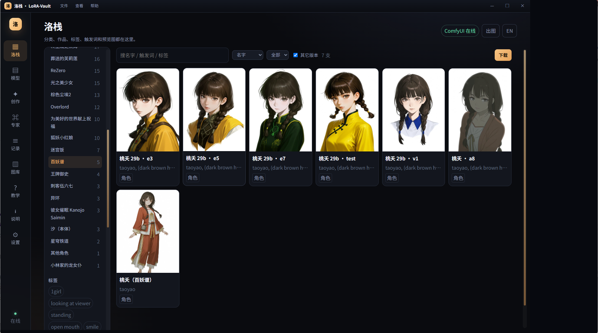
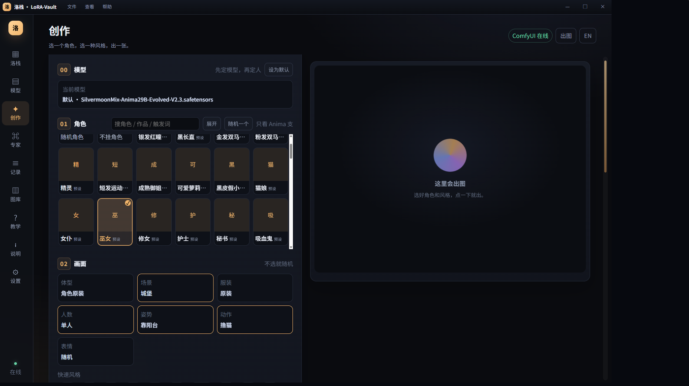
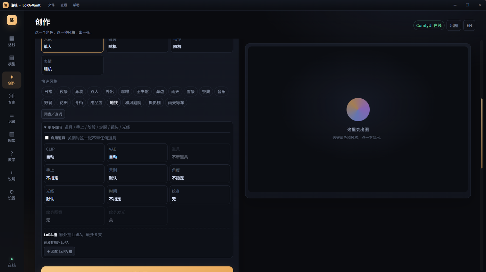
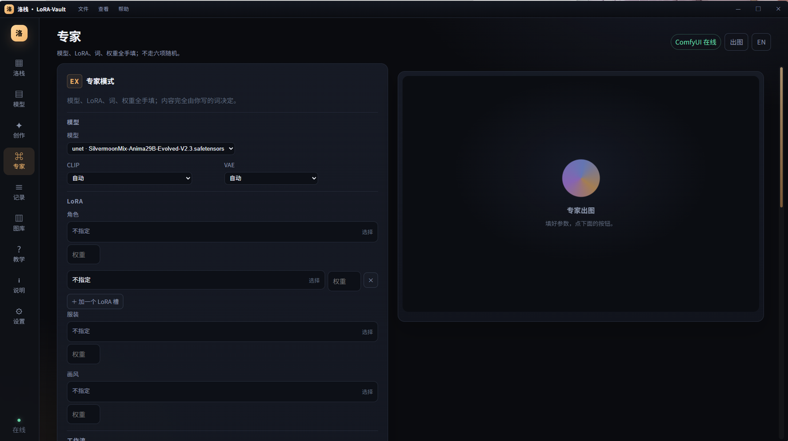
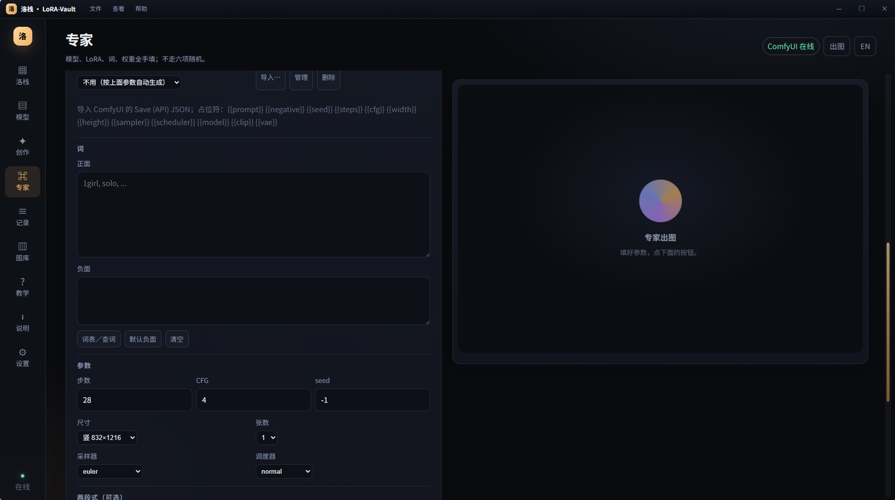
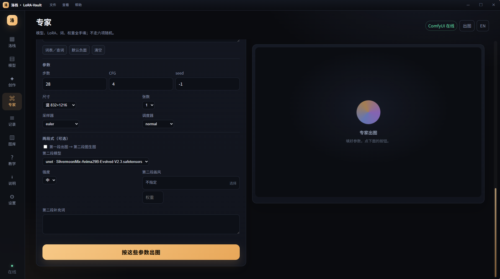
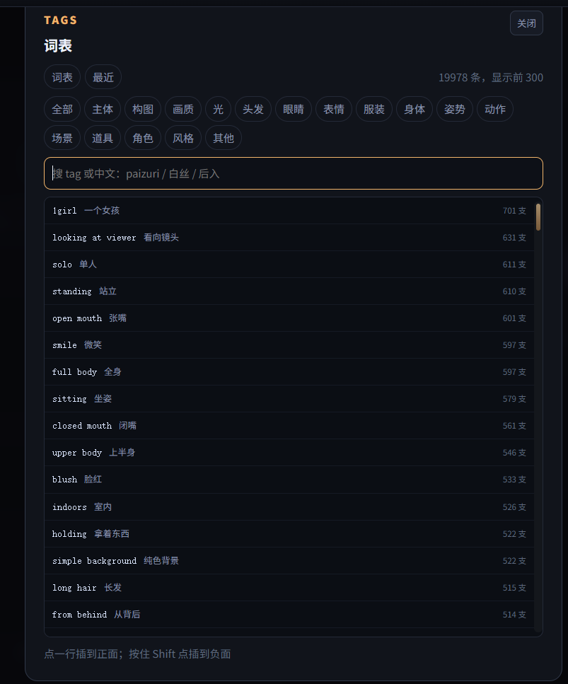
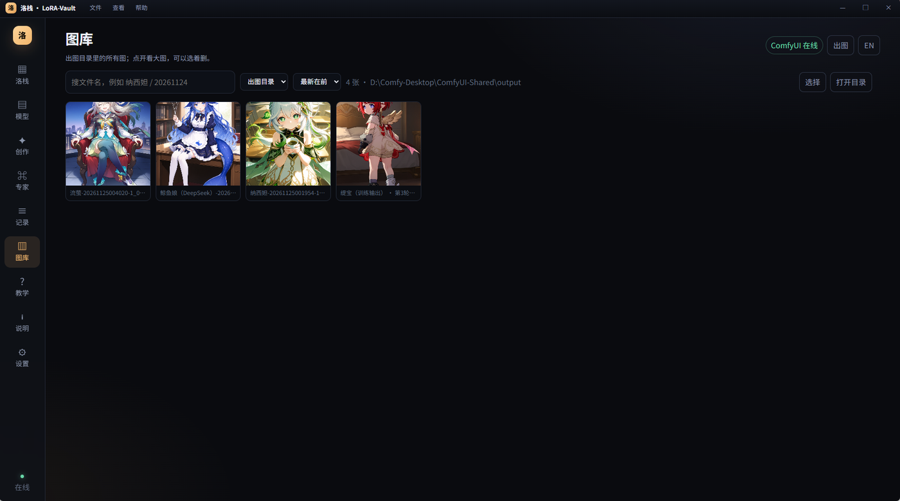

<p align="center">
  
</p>

<h1 align="center">Luozhan · LoRA-Vault</h1>

<p align="center">
  Local LoRA library · one-click generation · Civitai downloads · runs entirely on your own machine
</p>

<p align="center">
  
  
  
  
</p>

<p align="center">
  <a href="README.md">中文</a> · <b>English</b>
</p>

---



## What it is

**Luozhan** is a Windows desktop app for managing local LoRA files and generating images through a local ComfyUI instance.

It scans the `.safetensors` files on your disks into a local library, organizing categories, trigger words, feature words, outfit words, previews and sources. When you want an image, pick a character and a scene — ComfyUI does the rest.

- **No cloud account**: the library lives in a local SQLite file, images stay in local folders
- **No usage data collected**: no telemetry, no reporting
- **Listens on 127.0.0.1 only**: the backend binds to loopback by default
- **Civitai is optional**: the library and generation work fully without it

---

## Download

From [Releases](../../releases/latest):

| File | Purpose |
|---|---|
| `LoRA-Vault-1.0.0-setup.exe` | Windows installer (recommended) |
| `Luozhan-1.0.0-win64.zip` | Portable build |
| `latest.json` | Auto-update manifest |

> The installer is **not code-signed**, so Windows SmartScreen may warn about an unknown publisher. Choose "More info → Run anyway".

---

## Features

### 1. Local LoRA library

- Scans `.safetensors`, reading training tags, base model and trigger words from the file header
- Filter by category / work / tag; search by Chinese name, alias or trigger word
- Every LoRA keeps its preview, details, source page, feature words and outfit words
- Version families collapsed, duplicate detection, missing-file marking
- Watches the folder and refreshes when files are added, removed or renamed

### 2. One-click generation

Talks to your local ComfyUI directly — no external command-line tool needed.



- Pick a bundled checkpoint or a split base model; CLIP / VAE are matched automatically
- Selecting a character pulls its trigger and feature words
- Up to 8 LoRA slots: character / outfit / auxiliary / style
- Write the scene in Chinese; common phrases are converted to tags
- Scene, outfit, pose, action, expression, people count, shot, angle, lighting and props are chosen separately
- Two-character compositions and multi-image sequences supported
- Every result is logged — you can trace back which LoRAs, which prompt, which seed



### 3. Constraint system

The app does not just concatenate random tags. It enforces consistency:

- Outfit ↔ body state: changing clothes removes conflicting words
- Pose ↔ action: mutually exclusive combinations never appear together
- Scene ↔ outfit / props / time of day: no swimsuit in the snow, no umbrella indoors
- People count ↔ action / role / orientation: two-character poses get the right active party
- Expression ↔ context: grouped by situation so they don't fight each other
- Shot ↔ pose: high-angle never pairs with a back view, close-up never with a full body



### 4. Expert mode

Skip the randomizer and fill everything in yourself:



- Model, CLIP and VAE chosen separately
- Three LoRA slots — character / outfit / style — each with its own weight
- Hand-written positive and negative prompts
- Steps / CFG / seed / resolution / batch / sampler / scheduler
- Two-stage mode: first stage fixes structure, second stage swaps model for texture



- Import a ComfyUI `Save (API)` workflow JSON with placeholder substitution

### 5. Civitai downloads

- Paste a model page URL / AIR / version ID to queue downloads in bulk
- Pause, resume, and recover across restarts
- On completion the file is imported automatically along with trigger words, base model, description, previews and author info
- Search can be filtered by base model so you don't download unusable files

### 6. Tag dictionary



- 20,000 built-in tags, grouped into outfit / character / action / scene / quality and more
- The most-used section has Chinese translations — about **10,600 entries** currently
- Search in Chinese or English; untranslated entries fall back to English and still work
- Click a row to insert into the positive prompt, Shift-click for the negative

### 7. Gallery



- Lists everything in your output folder or finished-work folder
- Search, sort, open large previews, multi-select delete
- Reads subfolders recursively, so per-work folders work fine

### 8. Local HTTP API

For desktop AI assistants and scripts:

```powershell
curl -X POST http://127.0.0.1:8787/api/loras `
  -H "Content-Type: application/json" `
  -H "X-API-Token: <token from the Interface page>" `
  -d '{"filename":"new.safetensors","name":"Character","source_url":"https://civitai.com/models/xxx"}'
```

See [docs/API.md](docs/API.md) for details.

---

## First run

1. Install and open Luozhan
2. On first launch it tries to auto-detect your ComfyUI model, LoRA and output folders
3. If detection fails, fill the paths in Settings
4. Click "Scan disk" on the library page and wait for it to read the `.safetensors` headers
5. Go to Create, pick a character and a scene, click Generate

**Generation requires a working local ComfyUI instance that is running.** The app ships without models and does not download them for you.

---

## Requirements

| Item | Requirement |
|---|---|
| OS | Windows 10 / 11 (64-bit) |
| Generation | Local ComfyUI (default `http://127.0.0.1:8188`) |
| Disk | Installer is about 177 MB; library and images are extra |
| Network | Only needed for Civitai download / metadata; pure local generation works offline |

---

## Auto-update

The `latest.json` on the release page is the update manifest: version, installer URL, sha256 and release notes.

In Settings → Update, fill in:

```text
https://github.com/<owner>/<repo>/releases/latest/download/latest.json
```

The app then checks on launch and offers "Download and update" when a new version appears.

---

## Privacy

- Library data lives in `%APPDATA%\LoRA 库\data` by default
- Previews, thumbnails and generation history all stay local
- The backend listens on `127.0.0.1` only
- No telemetry; files unrelated to LoRA are never scanned
- Civitai requests happen only when you search, download or refresh metadata

Some content categories are disabled by default and can be adjusted in Settings.

---

## Development

```powershell
# Backend
cd lora-library
node server.mjs
# http://127.0.0.1:8787

# Desktop shell
cd desktop
npm start
```

Releasing:

```powershell
node scripts/release.mjs --notes-file dist/notes-1.0.0.txt
```

Artifacts land in `dist/release/`, `dist/installer/` and `dist/latest.json`.

---

## License

This project is **licensed for personal use**, not open source. You may install, run and back it up on your own devices. Redistribution, commercial use, reverse engineering and removal of copyright notices are not permitted.

See [LICENSE](LICENSE) for the full terms.

Third-party components (Node.js, Electron, ComfyUI, etc.) remain under their own licenses.
