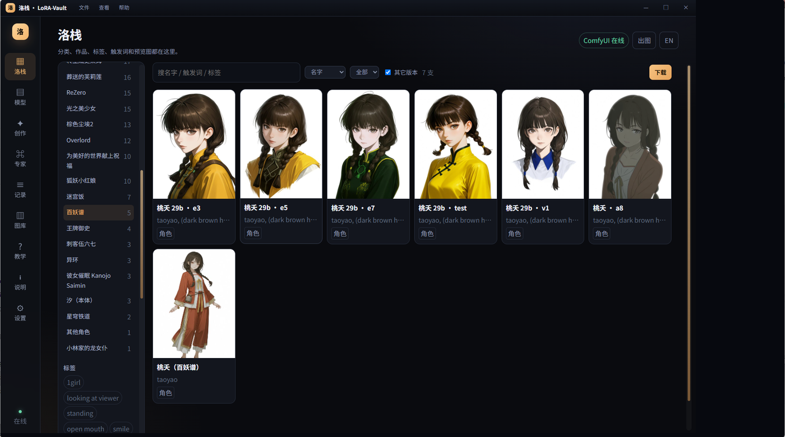
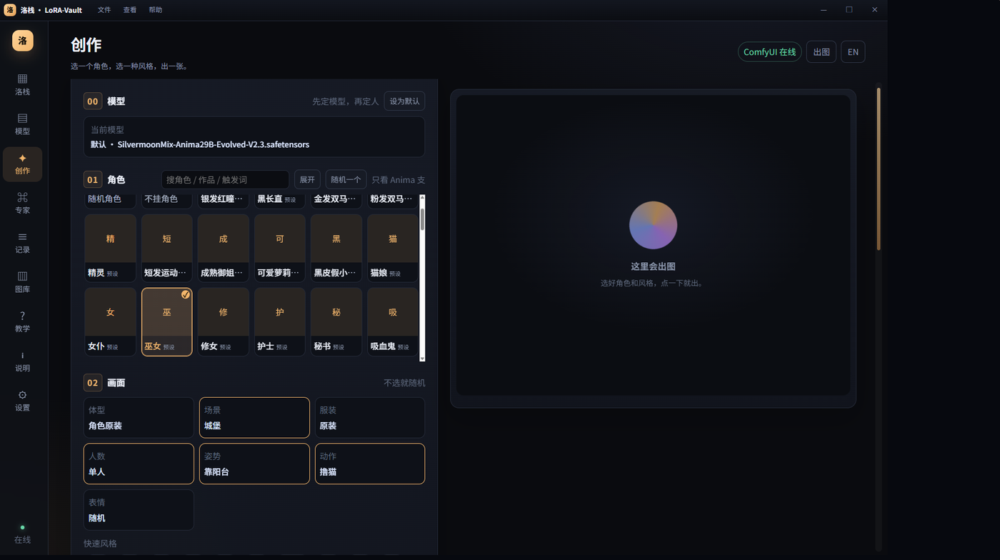
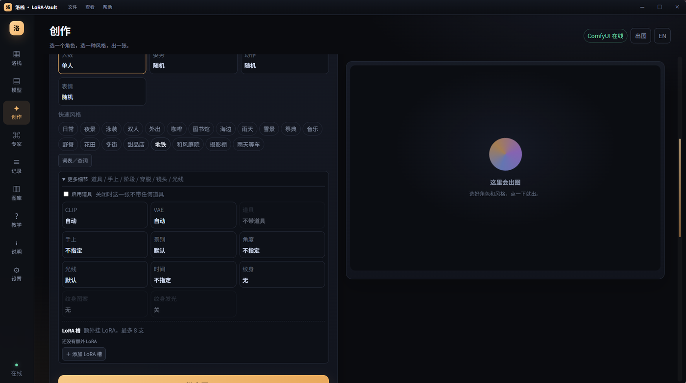
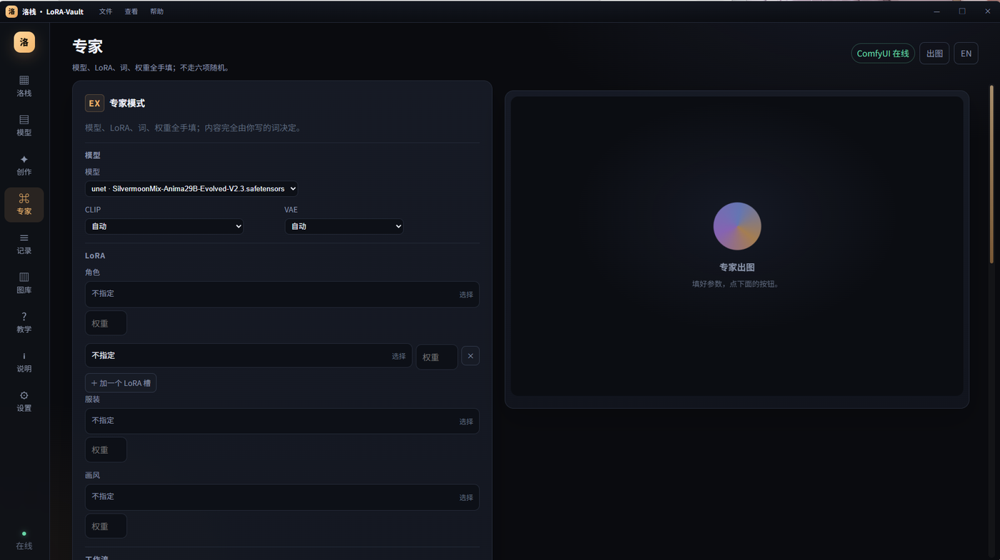
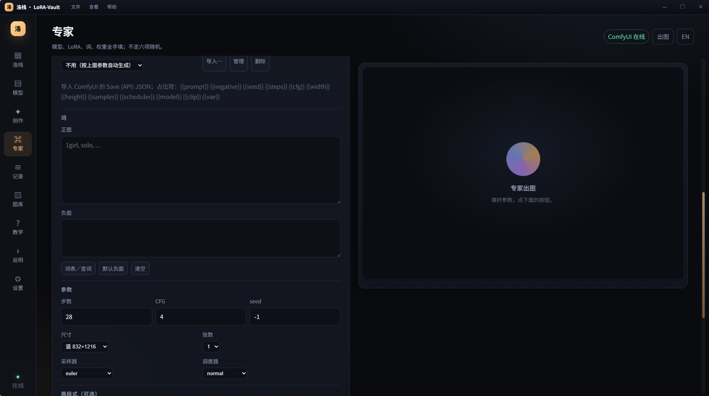
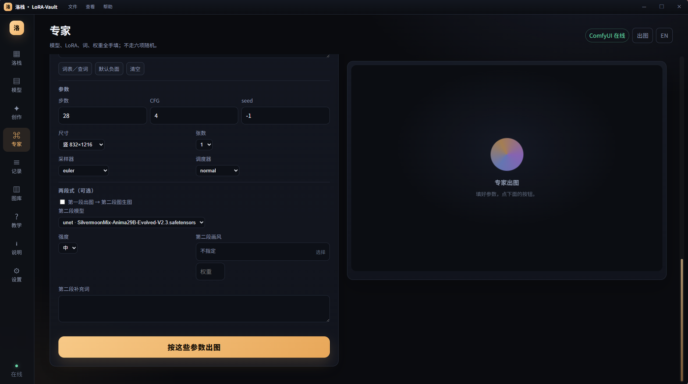
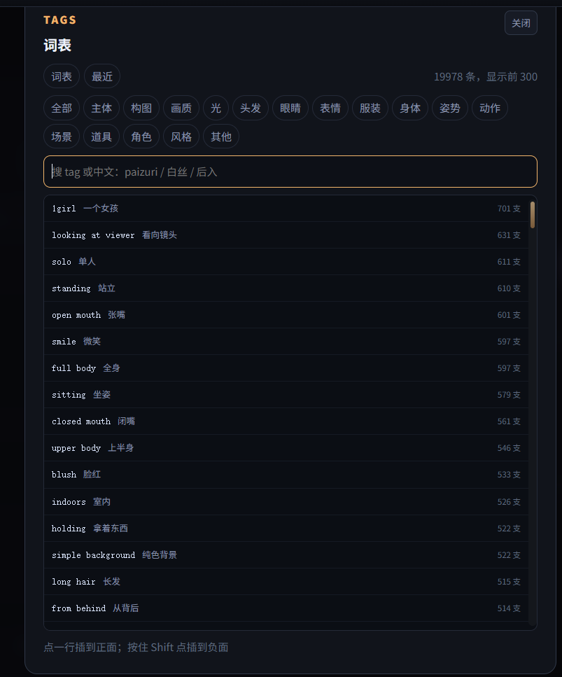
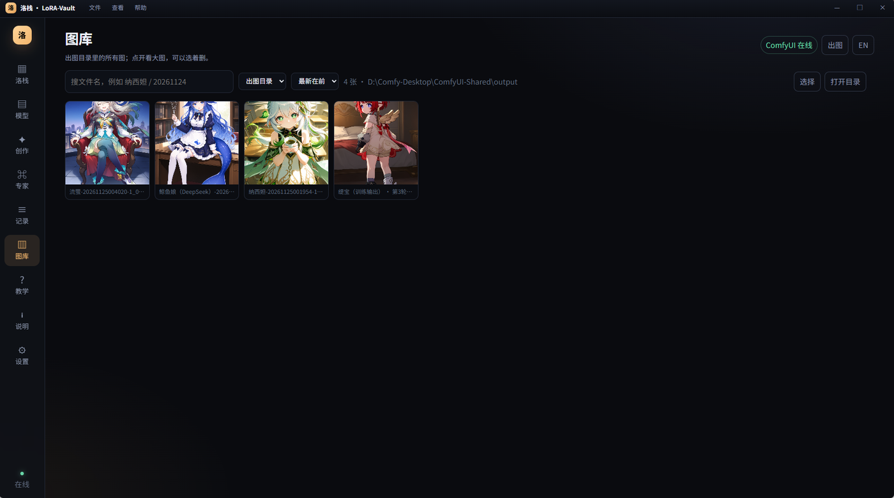

<p align="center">
  
</p>

<h1 align="center">洛栈 · LoRA-Vault</h1>

<p align="center">
  本地 LoRA 库 · 一键出图 · Civitai 下载 · 完全跑在自己机器上
</p>

<p align="center">
  
  
  
  
</p>

<p align="center">
  <b>中文</b> · <a href="README.en.md">English</a>
</p>

---



## 这是什么

**洛栈**是一个 Windows 桌面软件，用来管理本地 LoRA，并直接连本机的 ComfyUI 出图。

它把散在磁盘里的 `.safetensors` 扫进一个本地库，整理分类、触发词、特征词、服装词、预览图和来源；想出图时选角色、选画面，剩下交给 ComfyUI。

**适合你，如果**：硬盘里躺着几百上千支 `.safetensors`，名字都是 `xxx_v2_final_真的最终` 这种，想用哪支得翻文件夹猜；或者你会写提示词，但不想每次出图都连线搭一套节点。

- **不依赖云端账号**：库在本机 SQLite，图片在本机目录
- **不收集使用数据**：没有遥测、没有统计上报
- **只监听 127.0.0.1**：后端默认只在本机回环地址
- **Civitai 只是可选下载源**：不下模型也能完整用库和出图

---

## 下载

从 [Releases](../../releases/latest) 下载：

| 文件 | 用途 |
|---|---|
| `LoRA-Vault-1.0.0-setup.exe` | Windows 安装包（推荐） |
| `Luozhan-1.0.0-win64.zip` | 免安装版 |
| `latest.json` | 自动更新清单 |

> 安装包目前**没有代码签名**，Windows SmartScreen 可能提示「未知发布者」。选择「更多信息 → 仍要运行」即可。

---

## 主要功能

### 1. 本地 LoRA 库

- 扫描 `.safetensors`，读取头部训练标签、底模、触发词
- 按分类 / 作品 / 标签筛选，支持中文名、别名、触发词搜索
- 每支 LoRA 带预览图、详情、来源页、特征词、服装词
- 版本族收拢、重复文件体检、丢失记录标记
- 文件增删改名后自动刷新，不用手动点扫描

### 2. 一键出图

直接连本机 ComfyUI，不需要外面的命令行工具。



- 选整包 checkpoint 或分离式底模，自动配 CLIP / VAE
- 选角色后自动取触发词和特征词
- 挂角色 / 服装 / 辅助 / 画风 LoRA，最多 8 个槽
- 中文写画面，常见词自动转 tag
- 场景、服装、姿势、动作、表情、人数、景别、角度、光线、道具分开选
- 支持双人同框、多张连贯出图
- 出图结果自动记入历史，可反查用了哪几支、什么 prompt、什么 seed



### 3. 画面联动

不是把所有词随机拼在一起，而是带约束：

- 服装 ↔ 体型状态：换了衣服会自动摘掉冲突的词
- 姿势 ↔ 动作：互斥的不会同时出现，站姿不会配泡澡
- 场景 ↔ 服装 / 道具 / 时间：雪地不配泳装，室内不撑伞
- 人数 ↔ 动作 / 主客 / 朝向：双人动作按体位补主动方
- 表情 ↔ 情境：按情境分组，避免互相打架
- 景别 ↔ 姿势：俯拍不配背影，特写不配全身



### 4. 专家模式

不想走随机，就手动填：



- 模型、CLIP、VAE 分开选
- 三段 LoRA 槽：角色 / 服装 / 画风，各自带权重
- 正面词、负面词手写
- 步数 / CFG / seed / 尺寸 / 张数 / 采样器 / 调度器
- 两段式：第一段定结构，第二段换模型上质感



- 支持导入 ComfyUI 的 `Save (API)` JSON 工作流，占位符自动替换

### 5. Civitai 下载

- 贴模型页 / AIR / 版本号，批量加入下载队列
- 支持暂停、断点续传、重启恢复
- 下载完自动入库，并拉取触发词、特征词、底模、简介、预览图、作者信息
- 搜索支持按底模筛选，避免下到用不上的模型

### 6. 词表



- 内置 20,000 条常用 tag，按服装 / 人物 / 动作 / 场景 / 画风质量等分类
- 常用段已补中文，当前约 **10,600 条**有中文
- 中英都能搜；没有中文的回退英文，不影响出图
- 点一行插到正面，按住 Shift 点插到负面

### 7. 图库



- 列出出图目录或成品目录里的所有图
- 支持搜索、排序、看大图、多选删除
- 递归读子目录，按作品分文件夹也能认

### 8. 本地接口

给桌面端 AI / 脚本用的 HTTP API：

```powershell
curl -X POST http://127.0.0.1:8787/api/loras `
  -H "Content-Type: application/json" `
  -H "X-API-Token: <界面里「接口」页的 token>" `
  -d '{"filename":"新下的.safetensors","name":"角色名","source_url":"https://civitai.com/models/xxx"}'
```

接口说明见 [docs/API.md](docs/API.md)。

---

## 第一次启动

1. 安装后打开「洛栈」
2. 首次启动会尝试自动检测 ComfyUI 的模型目录、LoRA 目录、图库目录
3. 检测不到就进「设置」手动填路径
4. 库页点「扫描磁盘」，等它读完 `.safetensors` 头部
5. 去「创作」选角色、选画面，点「一键出图」

**出图需要本机已经装好 ComfyUI，并且开着。** 软件本身不带模型，也不提供模型下载。

---

## 系统要求

| 项目 | 要求 |
|---|---|
| 系统 | Windows 10 / 11（64 位） |
| 出图 | 本机 ComfyUI（默认 `http://127.0.0.1:8188`） |
| 磁盘 | 安装包约 177 MB；库和图另算 |
| 网络 | 只有 Civitai 下载 / 补全时需要；纯本地出图不需要 |

---

## 自动更新

发布页的 `latest.json` 是更新清单，里面带版本号、安装包地址、sha256 和更新说明。

在「设置 → 更新」里填：

```text
https://github.com/<owner>/<repo>/releases/latest/download/latest.json
```

之后打开软件会自动检查；有新版会显示「下载并更新」。

---

## 隐私

- 库数据默认在 `%APPDATA%\LoRA-Vault\data`（老版本是 `%APPDATA%\LoRA 库`，第一次启动会自动复制过去）
- 预览图、缩略图、出图记录都在本机
- 后端只监听 `127.0.0.1`
- 不发送遥测；不扫描与 LoRA 无关的文件
- Civitai 请求只在用户主动搜索 / 下载 / 补全时发生

部分内容类型默认关闭，可在设置里自行调整。

---

## 开发

```powershell
# 后端
cd lora-library
node server.mjs
# http://127.0.0.1:8787

# 桌面壳
cd desktop
npm start
```

发版：

```powershell
node scripts/release.mjs --notes-file dist/notes-1.0.0.txt
```

产物在 `dist/release/`、`dist/installer/` 和 `dist/latest.json`。

---

## 许可

本项目为**个人使用授权**，不是开源项目。允许在自有设备上安装、运行、备份；禁止再分发、商用、反向工程或移除版权声明。

完整条款见 [LICENSE](LICENSE)。

第三方组件（Node.js、Electron、ComfyUI 等）分别遵循其自身许可证。
